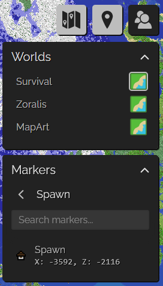

# 🗺️ Live Server Maps

***

Explore AshBlossom from your browser! Use these links to find shops, track your builds, or admire the gallery.

#### 🌲 Survival World (Overworld)

This is our "Never Reset World" where you build, survive, and thrive.

* [View the Overworld Map](http://map.ashblossom.com:8080/#minecraft_overworld;flat;848,64,-1680;1) 🏠

#### 🛍️ Zoralis (Shopping District)

Our dedicated hub for player shops and the server economy. Find the best deals here!

* [View the Zoralis Shopping Map](http://map.ashblossom.com:8080/#minecraft_zoralis;flat;-104940,64,193225;6) 💎

#### 🎨 The Art World

The dedicated dimension for massive map art projects and creative masterpieces.

* [View the Art Gallery Map](http://map.ashblossom.com:8080/#minecraft_mapart;flat;-4,64,-4;3) 🖌️&#x20;

***

#### 💡 Why use the Web Map?

* 📍 Navigation: Find your exact coordinates without getting lost.
* 👥 Player Tracking: See who is currently online and where they are working.
* 🏘️ Claim Planning: View existing claims to find the perfect spot for your next base.

\
**If you go to a black screen use the options:**\
**Markers** take you to spawn and you can see the **other maps** from selection: 
